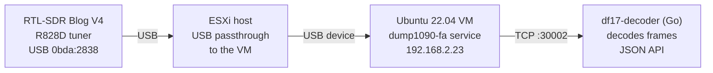

# ADS-B Receiver: Installing and Configuring dump1090-fa

Updated: 2026-11-19

## Overview

An RTL-SDR Blog V4 dongle feeds dump1090-fa, which runs as a systemd service on an Ubuntu 22.04 VM on ESXi and serves raw Mode S frames on TCP port 30002 to the Go decoder.



Only the VM step needs setup work; the decoder reaches it over the LAN on port 30002.

| Component | Details |
| --- | --- |
| Dongle | RTL-SDR Blog V4 (RTL2832U + Rafael Micro R828D tuner), USB ID `0bda:2838`, stock antenna |
| Host | ESXi, dongle passed through over USB to the VM |
| VM | Ubuntu 22.04.5 LTS, IP `192.168.2.23` |
| Demodulator | dump1090-fa built from source (github.com/flightaware/dump1090), installed as `/usr/local/bin/dump1090` |
| Consumer | `df17-decoder` (Go), reads `tcp://192.168.2.23:30002` |
| Receiver position | antenna latitude and longitude, written as `<LAT>` and `<LON>` in this guide |

First results: 7 aircraft at once with a stock indoor antenna, maximum range 29 nm.

## Quick test on macOS

On a Mac, Homebrew has a prebuilt dump1090-fa and a librtlsdr that already supports the V4, so a test takes minutes.

1. Install: `brew install dump1090-fa`. The formula installs the binaries `dump1090` and `view1090`, not `dump1090-fa`.
2. Check the dongle with `rtl_test -t`. Look for `RTL-SDR Blog V4 Detected`. The final line `No E4000 tuner found, aborting.` is expected: `-t` only works with E4000 tuners.
3. See aircraft: `dump1090 --interactive --lat <LAT> --lon <LON>`.
4. Network mode: `dump1090 --net --quiet --lat <LAT> --lon <LON>`, then `nc localhost 30002` shows raw frames.

Giving `--lat`/`--lon` lets dump1090 decode a position from a single CPR frame and show distances (`MaxD`). Replace `<LAT>`/`<LON>` with your receiver position; two decimal places (about 1 km) are enough.

## ESXi: pass the dongle to the VM

The VM needs a USB controller and the dongle attached as a host USB device; USB device passthrough is what this setup uses.

1. Plug the dongle into the ESXi host and shut down the VM.
2. Edit Settings → Add other device → **USB controller** (USB 2.0 if offered; the dongle is a USB 2.0 device).
3. Add other device → **USB device** → the Realtek RTL2838 / RTLSDRBlog Blog V4.
4. Power on and check inside the VM:

```bash
lsusb | grep -i 2838
# Bus 001 Device 002: ID 0bda:2838 Realtek Semiconductor Corp. RTL2838 DVB-T
```

If the dongle is missing from the USB device list, check the USB arbitrator on the host (SSH):

```bash
/etc/init.d/usbarbitrator status
/etc/init.d/usbarbitrator start
chkconfig usbarbitrator on
```

The more robust alternative is PCI passthrough of a whole USB controller (Host → Manage → Hardware → PCI Devices, host reboot, then Add PCI device to the VM with all guest memory reserved). Keep it in mind if the wedge in Troubleshooting becomes frequent.

## Ubuntu 22.04: V4 driver

Ubuntu 22.04's stock librtlsdr is too old for the V4, so the RTL-SDR Blog driver replaces it; on 24.04 the stock packages already work.

Remove any old librtlsdr:

```bash
apt purge ^librtlsdr
rm -rvf /usr/lib/librtlsdr* /usr/include/rtl-sdr* /usr/local/lib/librtlsdr* \
  /usr/local/include/rtl-sdr* /usr/local/include/rtl_* /usr/local/bin/rtl_*
```

Build and install the RTL-SDR Blog driver:

```bash
apt update
apt install -y git cmake pkg-config build-essential libusb-1.0-0-dev libncurses-dev usbutils
cd ~
git clone https://github.com/rtlsdrblog/rtl-sdr-blog
cd rtl-sdr-blog && mkdir build && cd build
cmake ../ -DINSTALL_UDEV_RULES=ON
make && make install
cp ../rtl-sdr.rules /etc/udev/rules.d/
ldconfig
```

Keep the kernel's DVB-TV driver off the dongle, then reboot:

```bash
echo 'blacklist dvb_usb_rtl28xxu' > /etc/modprobe.d/blacklist-dvb_usb_rtl28xxu.conf
reboot
```

Verify with `rtl_test` (Ctrl-C after about 20 s). Expect `RTL-SDR Blog V4 Detected` and at most one `lost at least 4 bytes` at startup.

From now on, don't install `librtlsdr-dev` or `rtl-sdr` from apt: they would bring the old library back.

## Build dump1090-fa

FlightAware's apt repository only has Raspberry Pi (ARM) packages, so on an x86 VM dump1090-fa is built from source; the build needs only the RTL-SDR backend.

```bash
cd ~
git clone https://github.com/flightaware/dump1090
cd dump1090
make BLADERF=no HACKRF=no LIMESDR=no
```

First run (Ctrl-C or `q` to quit):

```bash
./dump1090 --interactive --lat <LAT> --lon <LON>
```

In interactive mode the curses screen hides error messages on exit. To see why dump1090 stopped, run it without `--interactive`:

```bash
./dump1090 --net --quiet --lat <LAT> --lon <LON> 2>&1 | tee dump.log
```

Install the binary for the service (repeat after every rebuild, then restart the service):

```bash
install -m 755 ~/dump1090/dump1090 /usr/local/bin/dump1090
```

## Run as a systemd service

dump1090 runs as the `dump1090` user, resets the dongle before every start, restarts 10 s after any exit, and starts at boot.

Create the user and groups:

```bash
groupadd --system dump1090
useradd --system --no-create-home --shell /usr/sbin/nologin -g dump1090 dump1090
getent group plugdev || groupadd --system plugdev
usermod -aG plugdev dump1090
```

Options file `/etc/default/dump1090`:

```bash
# Options passed to dump1090. Edit, then: systemctl restart dump1090
# Only 30002 (raw AVR) and 30005 (Beast) stay open; see Network ports.
DUMP1090_OPTS="--device-type rtlsdr --net --quiet --lat <LAT> --lon <LON> --net-ri-port 0 --net-bi-port 0 --net-sbs-port 0"
```

Unit file `/etc/systemd/system/dump1090.service`:

```ini
[Unit]
Description=dump1090-fa ADS-B receiver (RTL-SDR Blog V4)
After=network-online.target
Wants=network-online.target
StartLimitIntervalSec=0

[Service]
Type=simple
User=dump1090
Group=dump1090
SupplementaryGroups=plugdev
EnvironmentFile=/etc/default/dump1090

# ESXi USB passthrough leaves the dongle wedged after a close: reset it before every start.
# "+" runs this step as root even though the service runs as the dump1090 user.
ExecStartPre=+/usr/bin/usbreset 0bda:2838
ExecStartPre=/bin/sleep 2
ExecStart=/usr/local/bin/dump1090 $DUMP1090_OPTS

Restart=always
RestartSec=10
TimeoutStartSec=120

NoNewPrivileges=true
ProtectSystem=strict
ProtectHome=true
PrivateTmp=true

[Install]
WantedBy=multi-user.target
```

Enable and check:

```bash
systemctl daemon-reload
systemctl enable --now dump1090
systemctl status dump1090
journalctl -u dump1090 -f
nc localhost 30002
```

`TimeoutStartSec=120` covers the reset, which took about 45 s once under ESXi. To count restarts since boot: `journalctl -u dump1090 --since today | grep -c "starting up"` (1 = no restarts).

## Network ports

`--net` opens five ports on all interfaces; the decoder needs only 30002 (and 30005 once Beast input is added).

| Port | Direction | Format | Needed |
| --- | --- | --- | --- |
| 30001 | input | raw AVR into dump1090 | no |
| 30002 | output | raw AVR, `*8D...;` per frame | yes: Go decoder |
| 30003 | output | SBS/BaseStation CSV, decoded | no |
| 30004 | input | Beast binary into dump1090 | no |
| 30005 | output | Beast binary with timestamp and signal level | later: Beast input, MLAT feeders |

The input ports accept frames from anyone on the network. The service closes every port except 30002 and 30005 by setting it to `0` in `/etc/default/dump1090`:

```bash
DUMP1090_OPTS="--device-type rtlsdr --net --quiet --lat <LAT> --lon <LON> --net-ri-port 0 --net-bi-port 0 --net-sbs-port 0"
```

Apply with `systemctl restart dump1090` and check with `ss -tlnp | grep dump1090`. The owner should be `/usr/local/bin/dump1090` as the `dump1090` user, not a manual `./dump1090` running as root.

## Troubleshooting

The main problem seen so far: under ESXi USB passthrough, the dongle streams only for the first program that opens it after a reset.

| Symptom | Cause | Fix |
| --- | --- | --- |
| `Abnormal exit.` after about 30 s in `--interactive` | real error hidden by the curses screen | run without `--interactive` to see the message |
| `No samples received from the SDR for a long time. Maybe the hardware is wedged?` | dongle wedged after a previous program closed it; no kernel USB errors in `dmesg` | `usbreset 0bda:2838`, then start; the service does this before every start |
| `rtl_sdr -f 1090000000 -s 2000000 -n 4000000 /tmp/test.bin` hangs | same wedge (a working dongle writes 8 MB in about 2 s) | `usbreset 0bda:2838` |
| `status=216/GROUP`, `Failed to determine group credentials` | a group in the unit file doesn't exist | create the `dump1090` or `plugdev` group (see the service section) |
| `usb_open error -3` | udev rule doesn't give the service user access | remove `User=`, `Group=`, `SupplementaryGroups=` to run as root |
| `usb_claim_interface error -6` | kernel DVB driver or another dump1090 holds the dongle | blacklist `dvb_usb_rtl28xxu`; `pgrep -a dump1090`, kill the extra one |
| Ports owned by `./dump1090` as root | a manual copy running beside the service | kill it, `systemctl restart dump1090` |
| Aircraft shows altitude and squawk but no position, while Flightradar24 shows it on the map | no ADS-B Out: only Mode S replies (DF4/5/11/20/21), which carry no coordinates; FR24 computes the position by MLAT from 4+ receivers | nothing to fix; check the data source in the FR24 app (MLAT vs ADS-B) |

If the wedge starts happening mid-run (many "starting up" lines per hour), change the VM's USB controller type (2.0 ↔ 3.1, VM powered off), use another host port, or switch to PCI passthrough of a USB controller.

## Connect the Go decoder

The decoder reads raw frames from the VM over the LAN; no change on the VM is needed.

```yaml
source:
  url: tcp://192.168.2.23:30002
receiver:
  lat: <LAT>
  lon: <LON>
```

Record real traffic for replay tests (a few minutes is enough), then point the decoder at the file:

```bash
nc 192.168.2.23 30002 > testdata/capture.txt
```

```yaml
source:
  url: file://testdata/capture.txt
  replay_speed: 1.0
```

The decoder logs the first position of each aircraft at info level and later ones at debug; set `log.level: debug` to see every position.
